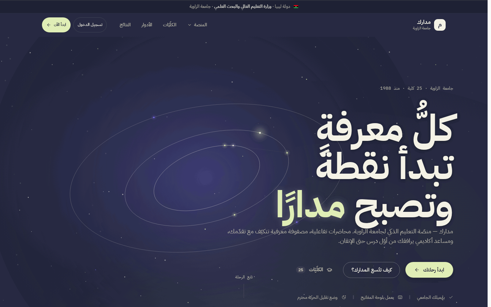
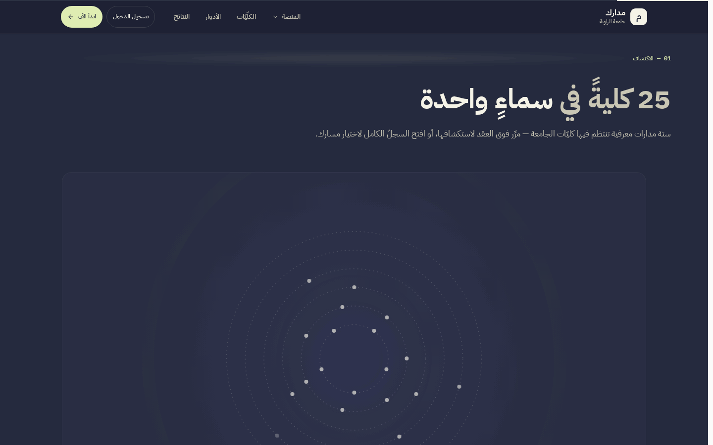
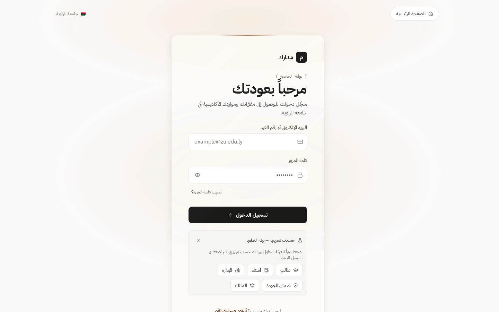
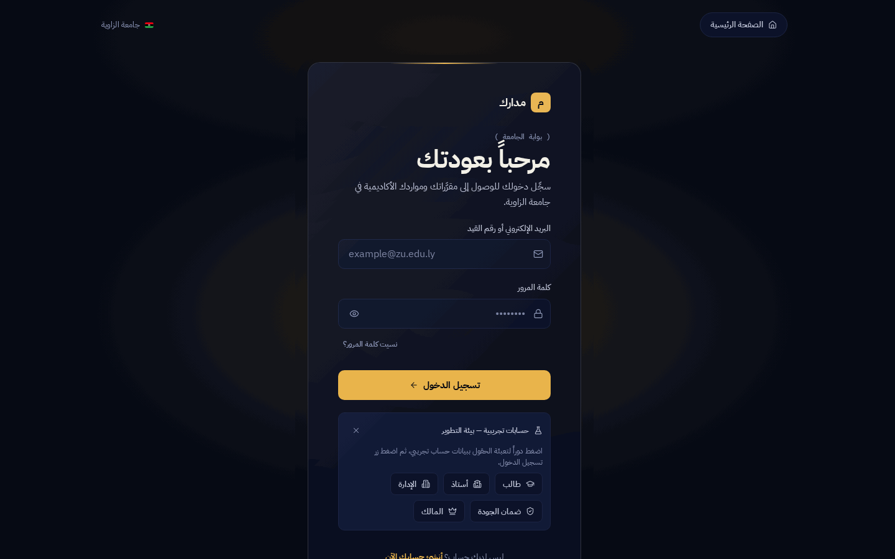
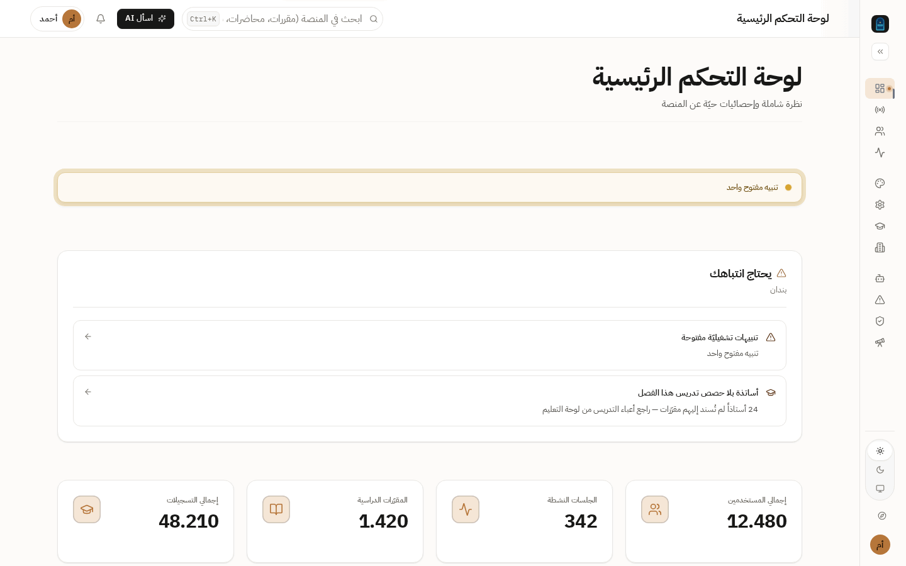
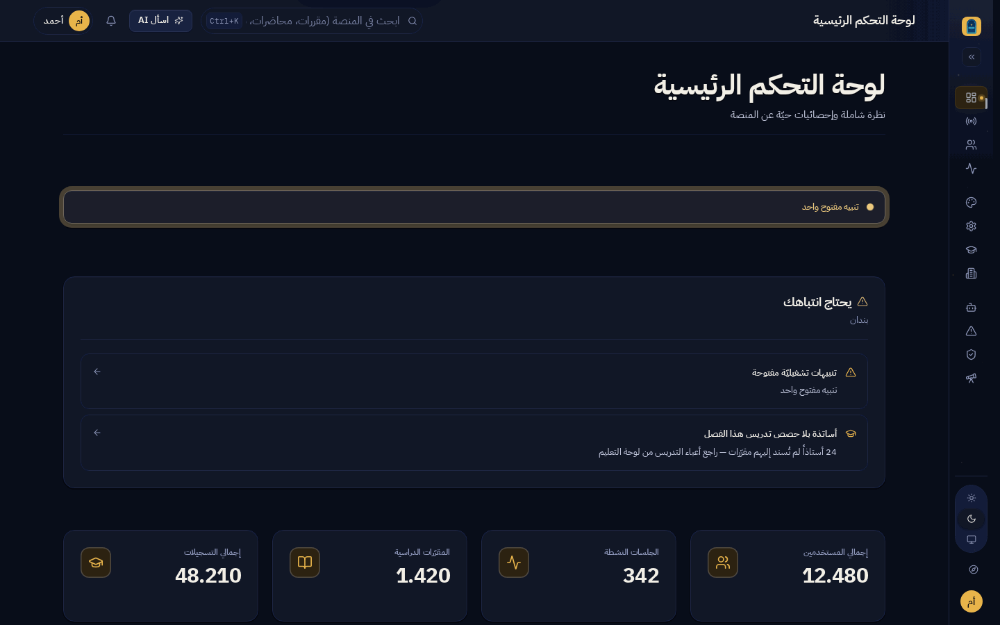

<div dir="rtl">

# مدارك — منصّة التعليم الذكي

**Madarek — Smart Learning Platform**: منصّة تعليم ذكي **مستقلّة**
(عربية-أولًا، صُنعت في ليبيا). لا يوجد أي اعتماد أو تبني رسمي من أي
جهة تعليمية — البيانات المؤسسية الظاهرة حاليًا (الكلّيات والحقائق)
هي بيانات عرض مرجعية لجامعة الزاوية من مصادرها العامة.

> 🌐 **عربية-أولًا** — النسخة الإنجليزية: [`README.en.md`](README.en.md)

## ما هو مدارك؟

**مدارك** منصة واحدة تخدم الطلاب والأساتذة والإدارة ومكتب الجودة ومالك
المنصة: فصول مقلوبة بأسئلة إدماجية، مصفوفة إتقان لكل مفهوم، دورة بحوث
علمية كاملة بقارئ PDF وشروح داخلية، مكتبة بحثية ببحث نصي عربي مطبّع،
قطاع رقابة جودة قرائي، وإدارة أكاديمية بحاكمية وسجل تدقيق — كل ذلك
عربي RTL بنظام تصميم أصيل بسمتين (ليلي ذهبي / نهاري نحاسي).

تقنيًا: خلفية **Express + TypeScript + Prisma 5** تخدم واجهات تحت
`/api/v1/*` وتقدم واجهة **React 18 + Vite** المبنية في خدمة واحدة، فوق
قاعدة **PostgreSQL (Neon)**، منشورة على **Render** بنشر تلقائي من `main`.

## حالة المشروع (بصدق)

| البند | الحالة |
|---|---|
| ميزات الأدوار الخمسة | **منفَّذة ومشحَنة** — 1975 اختبار واجهة + 1775 خلفية خضراء + 116 اختبار تكامل قاعدة بيانات (2026-10-18، جولات r141–r186) |
| نظام التصميم | موثّق في [`DESIGN.md`](DESIGN.md) — بوابة تكافؤ 163/163 خضراء |
| مساعد «Oasis» الذكي | **محرّك محلي حتمي معلن (gap-aware-composer) افتراضيًا + مزوّد LLM حقيقي اختياري** عبر `AI_PROVIDER` — التفصيل: [docs/02](docs/02-features.md) |
| فحص الانتحال | **محاكاة حتمية معلنة** (بلا خدمات خارجية) — التفصيل: [docs/02](docs/02-features.md) |
| رفع PDF ورحلات E2E | **منفَّذة** — رفع PDF خام خلف تجريد التخزين (محلي/S3/**postgres لوضع الطيار r175**) + 28 رحلة متصفّح محكمّة؛ i18n الإنجليزي وحده غير منفَّذ — [docs/02](docs/02-features.md) و[docs/11](docs/11-testing.md) و[docs/16](docs/16-decisions-and-limitations.md) |

## أبرز الميزات

- **الفصول المقلوبة** — محاضرات مسجلة بإدماجيات مصححة فوريًا، تتبع مشاهدة،
  حضور تلقائي عند الإتمام.
- **مصفوفة الإتقان** — تتبع إتقان لكل مفهوم، كشف فجوات، توصيات.
- **دورة البحوث** — إرسال → فحص → مراجعة الأستاذ بشروح داخلية على PDF →
  نشر في مكتبة ببحث نصي عربي (pdfjs كسول، تظليلات، بحث صفحات).
- **القطاع الرابع (الجودة)** — رقابة قرائية: مقررات، أساتذة، تفاعل، مناهج،
  رقابة اختبارات.
- **إدارة وحاكمية** — كليات/مقررات/تقارير من قاعدة البيانات، نموذج قدرات
  (17)، نطاق كليات، حرس «آخر مالك نشط»، سجل تدقيق كامل.
- **لوحة المالك** — مؤشرات، تنبيهات تشغيلية، أعلام ميزات، إعدادات.
- **مجتمع جامعي** — منشورات ووسوم، إعلانات بنطاقات، مسابقات وأحداث،
  إشعارات بعدّاد حي.
- **تدريب ذاتي وألعاب** — 11 مسارًا عربيًا بنقاط وشارات ولوحة صدارة.
- **واجهة تعريفية حرفية** — «سماء مدارك» وكوكبة 25 كلية برسم canvas بلا
  اعتماديات.
- **اختبارات إلكترونية** — بنك أسئلة وقوالب ومحاولات بتصحيح مطابقة صارم.

لقطات الشاشة (1440×900 من التطبيق الحي — النمطان):

| | |
|---|---|
| **الهبوط — Orbit Ink** |  |
| **كوكبة الكليات (25 كلية)** |  |
| **الدخول — فاتح (كريمي/نحاسي)** |  |
| **الدخول — داكن (ليلي/ذهبي)** |  |
| **لوحة المالك — فاتح** |  |
| **لوحة المالك — داكن** |  |

*التعليقات الكاملة وملاحظات الالتقاط: [`docs/screenshots/README.md`](docs/screenshots/README.md).*

## مركز التوثيق

الدليل العربي الكامل في [`docs/`](docs/README.md) — وثائق مرقمة 01–16
+ وثائق قطاعات. أسرع الروابط:

| أريد… | اذهب إلى |
|---|---|
| فهم المشروع وميزاته | [`docs/01-overview.md`](docs/01-overview.md) · [`docs/02-features.md`](docs/02-features.md) |
| فهم المعمارية والمخططات | [`docs/03-architecture.md`](docs/03-architecture.md) |
| خريطة المستودع و«أين أعدّل» | [`docs/04-repository-map.md`](docs/04-repository-map.md) |
| التشغيل محليًا | [`docs/05-setup.md`](docs/05-setup.md) |
| متغيرات البيئة | [`docs/06-configuration.md`](docs/06-configuration.md) |
| قاعدة البيانات | [`docs/07-database.md`](docs/07-database.md) + [`docs/DATABASE-REFERENCE.md`](docs/DATABASE-REFERENCE.md) |
| واجهات API | [`docs/08-api-reference.md`](docs/08-api-reference.md) + [`docs/API-REFERENCE.md`](docs/API-REFERENCE.md) |
| رحلات المستخدمين | [`docs/09-user-journeys.md`](docs/09-user-journeys.md) |
| الأمان | [`docs/10-security.md`](docs/10-security.md) + [`SECURITY.md`](SECURITY.md) |
| الاختبارات والفحوص | [`docs/11-testing.md`](docs/11-testing.md) |
| النشر | [`docs/12-deployment.md`](docs/12-deployment.md) |
| الصيانة/استكشاف الأخطاء | [`docs/13-maintenance.md`](docs/13-maintenance.md) · [`docs/14-troubleshooting.md`](docs/14-troubleshooting.md) |
| دليل التطوير والقرارات | [`docs/15-development-guide.md`](docs/15-development-guide.md) · [`docs/16-decisions-and-limitations.md`](docs/16-decisions-and-limitations.md) |
| وكلاء الذكاء الاصطناعي | [`AGENTS.md`](AGENTS.md) |
| مرجع التصميم | [`DESIGN.md`](DESIGN.md) |

## البدء السريع

المتطلبات: **Node.js `>=20 <25`** و**npm** وقاعدة PostgreSQL (Neon مجاني
يكفي). التفصيل الكامل: [`docs/05-setup.md`](docs/05-setup.md).

```bash
git clone https://github.com/ahmadmedo1012/madarek.git && cd madarek
cp .env.example backend/.env       # املأ DATABASE_URL + سريّي JWT (بدون أي قيم حقيقية هنا)
npm install

npm run db:migrate                 # تطبيق المخطط على قاعدتك
npm run db:seed                    # بذر البيانات التجريبية

# نافذتان:
npm run dev                        # الخلفية :4000
npm run dev:web                    # الواجهة :5173 (proxy ‏/api → :4000)
```

**حسابات عرض** بعد البذر — **كلمة المرور لا تُنشر هنا** (r188: أُخرجت من الوثائق العامة؛ تُسلَّم للمشغّل عبر `docs/runbooks/operator-pilot-guide.md` وقناة تسليم خاصة)،
موزّعة على **مؤسستَي العرض**:

- جامعة مدارك التجريبية (مؤسّسة العرض الاصطناعية r188 — 25 كلية على ثلاثة حرَم معرفيّة): `student@demo.madarek.ly` ·
  `teacher@demo.madarek.ly` · `admin@demo.madarek.ly` · `quality@demo.madarek.ly`
- مؤسسة الأندلس التعليمية (المؤسسة التجريبية الثانية — تُثبت عزل
  المؤسسات): `student2@demo.madarek.ly` · `teacher2@demo.madarek.ly` ·
  `admin2@demo.madarek.ly`
- مالك المنصة (بلا عضوية — نطاق المنصة): `owner@demo.madarek.ly`

> **تجربة العزل بين المؤسستين:** سجّل دخولك بـ`student@demo.madarek.ly` ثم
> بـ`student2@demo.madarek.ly` — الرقمان الجامعيان متطابقان عمدًا
> (`UZ-2024-00001`) ورمز المقرر `SE301` موجود في المؤسستين، وكلٌّ منهما
> يرى مقررات مؤسسته فقط (واختبار الشعبة الأخرى يُرفض 403). البذر يعمل
> بعد كل نشر على Render تلقائيًا وغير مدمّر (r180).

## الاختبارات والفحوص

```bash
npm run lint                         # ESLint — 0 أخطاء إلزامية
npm run typecheck                    # tsc — src + tests، الجهتان (بلا DB)
npm test                             # 1975 واجهة + 1775 خلفية (بلا DB؛ يشمل 7 اختبارات S3 حيّة ضد s3rver) — و npm run test:integration يضيف 116 اختبار تكامل على قاعدة محلية معزولة (منها 14 عابرة للمؤسستين لعزل r179 و 2 لأمان إعادة تشغيل البذرة r182)
node scripts/verify-parity-export.mjs  # بوابة التكافؤ 163/163
bash scripts/check-icons.sh            # انضباط Lucide
bash scripts/check-motion-tokens.sh    # رموز الحركة
bash scripts/check-csp-hash.sh         # بصمات CSP
npm run validate:colleges              # هوية 25 كلية (AA)
```

الأرقام أعلاه نتائج تشغيل فعلي موثق — منهجية وحدود التغطية:
[`docs/11-testing.md`](docs/11-testing.md).

## متغيرات البيئة (الإلزامية فقط)

| المتغير | ملاحظات |
|---|---|
| `DATABASE_URL` | سلسلة Neon pooler ‏(`sslmode=require&channel_binding=require`) |
| `JWT_ACCESS_SECRET` | 64 بايت hex عشوائية: `node -e "console.log(require('crypto').randomBytes(64).toString('hex'))"` |
| `JWT_REFRESH_SECRET` | 64 بايت hex **مختلفة** |

الاختيارية (`CORS_ORIGINS` — تستبدل الافتراضي عند ضبطها، `INTERNAL_SERVICE_TOKEN`,
`DIRECT_DATABASE_URL`, `PORT`): الجدول الكامل وسلوك كل متغير في
[`docs/06-configuration.md`](docs/06-configuration.md). لا تضع أسرارًا حقيقية
في أي ملف متتبع.

## النشر على Render (3 خطوات)

1. اربط المستودع بـRender: **New + → Blueprint** — `render.yaml` ينشئ
   الخدمة ويولّد سريّي JWT تلقائيًا.
2. من تبويب **Environment**: ضع `DATABASE_URL` (سلسلة Neon pooler).
3. ادفع إلى `main` — البناء يطبق الترحيلات (`prisma migrate deploy`)
   ثم يقلب خدمة واحدة تخدم API وSPA وفحص صحة `/api/v1/health`.

التفصيل والتحقق بعد النشر والتراجع: [`docs/12-deployment.md`](docs/12-deployment.md).

## بنية المستودع (مختصرة)

```text
madarek/
├── backend/          Express + TS · Prisma (79 نموذجًا/31 enum) · 222 endpoint · storage/papers/
├── frontend/         React 18 + Vite · src/styles/ سلسلة الرموز · 18 CSS · tests/ (vitest)
├── docs/             الدليل العربي 01–16 + modules/ + المراجع المولّدة + archive/
├── specs/            مواصفات الميزات (نية زمنية — الحالة في SPECS-REFERENCE)
├── audits/           تقارير تدقيق بصري تاريخية (جولتا 4 و5)
├── scripts/          بوابات الجودة + أدوات المشغِّل (db:backup/db:restore/smoke) + لقطات محلية
├── tools/            boot-pg.sh — PostgreSQL مدمج للتطوير
└── render.yaml       مخطط Render
```

الخريطة المفصلة «أين أعدّل ماذا»: [`docs/04-repository-map.md`](docs/04-repository-map.md).

## المساهمة والإبلاغ

- قواعد المساهمة وبوابات الجودة: [`CONTRIBUTING.md`](CONTRIBUTING.md) —
  والتزامات بصيغة `type(rNNN): موضوع`.
- الإبلاغ عن مشكلة: قوالب [Issues](.github/ISSUE_TEMPLATE/) — **المشكلات
  الأمنية بقنوات خاصة فقط** وفق [`SECURITY.md`](SECURITY.md).
- الترخيص: احتكاري — [`LICENSE`](LICENSE) (نشر للعرض والمرجع فقط).

---

*الاسم التطويري للمشروع: مدارك (Madarek) · منصّة مستقلّة · الإنتاج: [madarek.onrender.com](https://madarek.onrender.com)*

</div>
